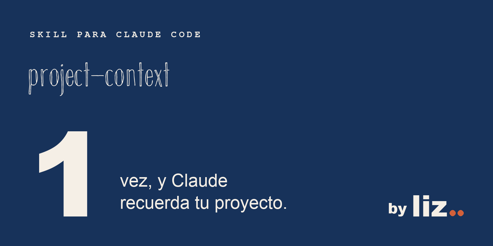

<p align="center">
  
</p>

<p align="center">
  Una skill gratuita <b>by liz●●</b> · Encuéntrame en Instagram: <a href="https://www.instagram.com/bylizllanos/">@bylizllanos</a>
</p>

---

# project-context

Una skill para Claude Code que hace que Claude no se olvide de tu proyecto.

## El problema

Cada vez que abres un chat nuevo, Claude empieza en blanco. No sabe qué decidiste ayer, qué le corregiste ni dónde quedaron. Te toca explicarle todo otra vez, y a veces repite errores que ya habías arreglado.

## La solución

Esta skill le pone al proyecto una libreta de notas. Mientras trabajas, Claude anota solo:

- lo que decidieron y por qué,
- lo que le corregiste,
- cómo te gusta que haga las cosas,
- lo que quedó pendiente y dónde quedaron.

Cuando abres un chat nuevo, Claude lee esa libreta antes de empezar. Tú no tienes que pedirle que anote ni que lea nada.

Se configura una sola vez por proyecto.

## Antes y después

Sin la skill, en un chat nuevo:

> Tú: Sigamos con el reporte.
> Claude: ¡Claro! ¿De qué reporte hablamos? ¿Qué datos usamos?

Con la skill, en un chat nuevo:

> Tú: Sigamos con el reporte.
> Claude: Quedamos en la sección de resultados. Faltan las gráficas por región. Recuerdo que decidiste usar los datos de 2024 y no los de 2023, porque los de 2023 estaban incompletos.

---

## Instalación (una sola vez)

Necesitas la app de Claude (pestaña Code) o Claude Code en la terminal, en un Mac.

La forma más fácil: abre un chat en Claude Code y escribe esto.

```text
Instala la skill https://github.com/byliz-ai/project-context en ~/.claude/skills/project-context y corre su instalador de hooks.
```

Si prefieres hacerlo tú, pega estos dos comandos en la terminal:

```bash
git clone https://github.com/byliz-ai/project-context.git ~/.claude/skills/project-context
```

```bash
bash ~/.claude/skills/project-context/hooks/install.sh
```

Después cierra y vuelve a abrir los chats que tenías abiertos.

---

## ¿Qué escribo en el chat?

| Tu situación | Escribe esto |
| --- | --- |
| Voy a empezar un proyecto nuevo | `/project-context` |
| Ya tengo un proyecto con varios chats | `/project-context` |
| Tengo un chat normal en claude.ai y quiero seguirlo en un proyecto | `/project-context handoff` |
| Ya lo configuré antes | Nada. Solo trabaja. |

No te preocupes por elegir mal: si escribes solo `/project-context`, Claude revisa la carpeta y decide cuál de los casos aplica. Antes de empezar te dice cuál eligió.

Abajo hay un ejemplo de cada caso.

---

### Caso 1. Proyecto nuevo

Tienes una carpeta nueva o casi vacía y quieres que Claude lleve la memoria desde el primer día.

1. Abre la carpeta del proyecto en Claude Code.
2. Escribe:

```text
/project-context
```

También funciona en tus palabras:

```text
Deja este proyecto listo para que otros chats sigan sin empezar de cero.
```

Qué pasa:

- Claude crea una carpeta `.claude-context/` con la libreta del proyecto.
- Agrega unas instrucciones a tu archivo `CLAUDE.md` (si no existe, lo crea).
- Te muestra dónde quedaron y te pide revisar cualquier cosa que no pudo confirmar.

Desde ese momento ya anota solo.

---

### Caso 2. Proyecto que ya va andando

Llevas días o semanas trabajando en el proyecto, con varios chats. Quizás ya tienes tus propias notas, un `CLAUDE.md` o archivos tipo "pendientes" o "decisiones".

1. Abre la carpeta del proyecto en Claude Code.
2. Escribe:

```text
/project-context
```

O en tus palabras:

```text
Este proyecto ya tiene varios chats. Rescata las decisiones de los chats anteriores sin romper mi estructura.
```

Qué pasa:

1. Claude revisa tus archivos y lee todos los chats anteriores del proyecto.
2. Saca de ellos lo importante: decisiones, correcciones, preferencias y pendientes, con fecha.
3. Te muestra un plan con ejemplos de lo que encontró. **Hasta aquí no ha cambiado nada.**
4. Te pregunta algo así:

> ¿Cómo quieres organizar la memoria del proyecto?
> 1. Juntar todo en una carpeta nueva (recomendado si tus notas viejas ya no las usas)
> 2. Mantener tus archivos como están y agregar solo lo que falte

5. Cuando le dices que sí, escribe la libreta.

Lo que siempre respeta:

- No borra, no mueve y no renombra ninguno de tus archivos.
- No reescribe lo que ya tenía tu `CLAUDE.md`. Solo le agrega.
- Si lo vuelves a correr más adelante, solo revisa los chats nuevos.

> Consejo: al terminar, abre un chat nuevo para seguir trabajando. Los chats que ya estaban abiertos no se enteran del cambio.

---

### Caso 3. Pasar un chat normal a un proyecto

Tienes una conversación larga en claude.ai (el chat normal, fuera de Claude Code) y quieres continuarla en un proyecto con memoria.

Paso 1. En Claude Code, escribe:

```text
/project-context handoff
```

Claude te da un texto para copiar.

Paso 2. Pega ese texto en tu chat viejo de claude.ai. Claude te va a escribir un resumen completo de la conversación. Guárdalo como `HANDOFF.md` dentro de la carpeta del proyecto.

> Si son varios chats, repite el paso con cada uno y guárdalos con nombres distintos: `HANDOFF_presupuesto.md`, `HANDOFF_diseño.md`.

Paso 3. Abre esa carpeta en Claude Code y escribe:

```text
/project-context
```

Claude lee los `HANDOFF` y arma la libreta con ellos.

**Variante:** si estás en un chat de Claude Code que empezaste sin carpeta y quieres convertirlo en proyecto, escribe:

```text
Convierte este chat en un proyecto en la carpeta Documentos/Mi proyecto.
```

---

## Y después, ¿qué hago?

Nada especial. Trabaja como siempre. Cuando Claude anote algo, te avisa con una línea, por ejemplo:

> Anoté en decisions_log.md: usamos los datos de 2024 porque los de 2023 estaban incompletos.

Si algo quedó mal, corrígelo en el momento.

Cosas útiles que puedes escribir cuando quieras:

| Para | Escribe |
| --- | --- |
| Retomar | `¿Dónde quedamos?` |
| Recordar una decisión | `¿Por qué decidimos usar los datos de 2024?` |
| Guardar algo a propósito | `Anota que los reportes siempre van en PDF.` |
| Corregir una nota | `Lo que anotaste no es así: el cliente pidió Excel, no PDF.` |
| Revisar antes de cerrar | `Voy a parar por hoy, deja todo al día.` |

---

## Qué queda en tu carpeta

```
mi-proyecto/
├── CLAUDE.md                ← instrucciones que Claude lee al abrir cada chat
└── .claude-context/
    ├── 00_README_FIRST.md   ← de qué se trata el proyecto
    ├── project_status.md    ← qué está listo, qué falta y dónde quedamos
    ├── decisions_log.md     ← cada decisión, con fecha y motivo
    ├── preferences.md       ← cómo te gusta que se hagan las cosas
    ├── lessons_learned.md   ← lo que no funcionó y lo que sí
    └── open_issues.md       ← pendientes y dudas abiertas
```

Son archivos de texto normales. Puedes abrirlos y editarlos tú.

> En Mac, las carpetas que empiezan con punto están ocultas. Para verlas en el Finder, presiona Cmd + Shift + punto.

---

## Preguntas frecuentes

**¿Tengo que correrlo en cada chat?**
No. Una vez por proyecto. Los chats nuevos lo encuentran solos.

**¿Me va a borrar o cambiar mis archivos?**
No borra, no mueve y no renombra nada. En proyectos que ya van andando, te muestra el plan y espera tu aprobación antes de escribir.

**¿Funciona en el chat normal de claude.ai?**
No directamente, porque ese chat no tiene carpeta. Usa el Caso 3 para pasarlo a Claude Code.

**¿Mis notas se suben a internet?**
Se quedan en la carpeta del proyecto. Si esa carpeta está en Google Drive u OneDrive, se sincronizan como cualquier otro archivo. Si es un repositorio de git, tú decides si las subes. Claude nunca anota contraseñas ni claves.

**¿Qué pasa en carpetas que no tienen la libreta?**
Nada. La skill solo actúa donde la configuraste.

**¿Cómo la quito?**
Para quitar el aviso automático:

```bash
bash ~/.claude/skills/project-context/hooks/install.sh --uninstall
```

Para quitarla del todo, borra también la carpeta `~/.claude/skills/project-context`. Las libretas de tus proyectos se quedan donde están, por si las quieres conservar.

---

## Lo que conviene saber

- Claude anota casi todo solo, pero no es perfecto. Si algo importante se le escapa, dile "anota que...".
- Si tú o Google Drive cambian archivos mientras Claude trabaja, a veces revisa las notas sin que haga falta. No pasa nada: Claude dice "Registro al día" y sigue.
- En carpetas muy grandes puede saltarse alguna revisión.
- Para rescatar chats viejos, esos chats tienen que seguir guardados en tu computador. Claude Code borra los muy antiguos después de un tiempo.
- Está probada en Mac.

---

<details>
<summary>Para curiosos: cómo funciona por dentro</summary>

La skill tiene tres piezas:

1. **Las instrucciones en `CLAUDE.md`.** Claude Code lee ese archivo al abrir cada chat. Ahí dice cuándo anotar y en qué archivo.
2. **Dos hooks**, que son pequeños programas que Claude Code corre solo:
   - Al abrir un chat, le recuerda a Claude que el proyecto tiene libreta.
   - Al terminar cada respuesta, revisa si cambiaron archivos sin que se anotara nada, y si es así le pide a Claude revisar.
3. **Dos scripts** que leen los chats anteriores y los resumen, para el Caso 2.

Requisitos técnicos: `git` y `jq`. Los Mac con macOS 15 o más nuevo ya traen `jq`; en versiones anteriores, instálalo con `brew install jq`.

```
SKILL.md                 ← elige el caso y coordina
references/
  structure.md           ← los seis archivos y las instrucciones para CLAUDE.md
  init.md                ← Caso 1
  migrate.md             ← Caso 2
  handoff.md             ← Caso 3, con el texto para copiar
scripts/
  list-sessions.sh       ← lista los chats anteriores de un proyecto
  dump-session.sh        ← resume un chat en texto
hooks/
  claude-context-session.sh
  claude-context-check.sh
  install.sh             ← instala o quita los hooks
```

</details>

---

<p align="center">
  <b>by liz●●</b><br>
  Si te sirvió, cuéntame en Instagram: <a href="https://www.instagram.com/bylizllanos/">@bylizllanos</a>
</p>
